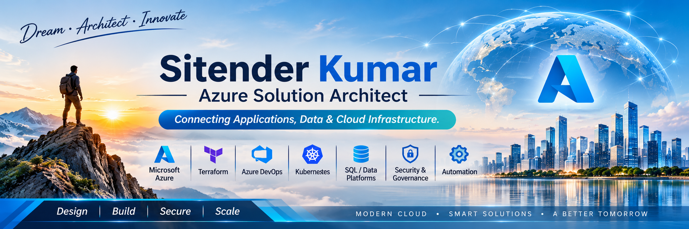

<!-- Hero Banner -->

 

<!-- Animated Typing Headline -->

 

<!-- Primary Action Badges -->

&nbsp;

&nbsp;

 

<!-- Executive Metrics Cards (Compact width - No extra left/right padding) -->
<table align="center">
  <tr>
    <td align="center" width="185px">
      <b>18+ Years Experience</b>
      Enterprise IT Leadership
    </td>
    <td align="center" width="200px">
      <b>8+ Years in Cloud</b>
      Microsoft Azure Specialist
    </td>
    <td align="center" width="185px">
      <b>27% OpEx Reduction</b>
      Platform Modernization
    </td>
    <td align="center" width="210px">
      <b>100% Automated IaC</b>
      Modular Terraform Pipelines
    </td>
  </tr>
</table>

---

### 👨‍💻 Professional Summary

> **Technology & Azure Solution Architect** with over **18 years** of enterprise IT engineering experience, including **8+ years** architecting, governing, and scaling platforms on **Microsoft Azure**.
>
> Specialized in architecting enterprise-grade cloud foundations, multi-subscription landing zones, and repeatable infrastructure-as-code automation that balance agility, compliance, and cost governance.

---

### 🏛️ Core Architectural Domains

#### ☁️ 01 / Cloud Architecture & Enterprise Landing Zones
> Designing scalable, enterprise-grade cloud topologies adhering strictly to Microsoft Cloud Adoption Framework (CAF).
- <kbd>Azure Landing Zones</kbd> <kbd>Management Groups</kbd> <kbd>Subscription Topology</kbd> <kbd>Azure Policy Enforcement</kbd> <kbd>Resource Hierarchy</kbd> <kbd>FinOps & Cost Governance</kbd>

#### 🌐 02 / Network Architecture & Zero Trust
> High-security enterprise networking ensuring zero public exposure and strict perimeter control.
- <kbd>Hub-Spoke Topology</kbd> <kbd>Virtual WAN</kbd> <kbd>Global VNet Peering</kbd> <kbd>Azure Firewall Premium</kbd> <kbd>Private Link</kbd> <kbd>Private Endpoints</kbd> <kbd>Split-DNS</kbd>

#### 🔐 03 / Identity, Security & Access Governance
> Enforcing least-privilege, identity-first access control and cryptographic security across enterprise boundaries.
- <kbd>Microsoft Entra ID (Azure AD)</kbd> <kbd>Privileged Identity Management (PIM)</kbd> <kbd>Azure RBAC</kbd> <kbd>Managed Identities</kbd> <kbd>Azure Key Vault</kbd> <kbd>Zero Trust</kbd>

#### 🏗️ 04 / Infrastructure as Code (IaC) Automation
> Building version-controlled, reusable, modular infrastructure delivery pipelines.
- <kbd>Terraform</kbd> <kbd>OpenTofu</kbd> <kbd>Terragrunt</kbd> <kbd>Remote State Locking</kbd> <kbd>Multi-Environment Isolation (Dev/QA/Prod)</kbd> <kbd>Drift Detection</kbd>

#### ⚙️ 05 / DevOps & Continuous Delivery
> Production-grade automated release pipelines with strict validation gates and automated rollbacks.
- <kbd>Azure DevOps</kbd> <kbd>GitHub Actions</kbd> <kbd>Multi-Stage YAML</kbd> <kbd>PR Quality Gates</kbd> <kbd>PowerShell</kbd> <kbd>Python</kbd> <kbd>Bash</kbd>

#### 🗄️ 06 / Enterprise Data & Platform Modernization
> Migrating legacy architectures to resilient, cloud-native managed data platforms.
- <kbd>SQL Server Always-On</kbd> <kbd>Azure SQL Managed Instance</kbd> <kbd>PostgreSQL on Ubuntu</kbd> <kbd>SSIS ETL Modernization</kbd> <kbd>.NET / C#</kbd>

---

### 💼 Measurable Delivery Outcomes

| Metric | Capability Domain | Enterprise Impact & Outcomes |
|:---:|:---|:---|
| 📉 **27%** | **OpEx Cost Reduction** | Modernized legacy on-premises transactional DBs & ETL workflows to Azure VMs and SQL Managed Instance. |
| ⚡ **40%** | **Performance Gain** | Engineered optimized database schemas, indexing strategies, and automated data processing pipelines. |
| 🚀 **30%** | **Faster Time-to-Market** | Accelerated multi-environment cloud resource rollout through reusable modular Terraform pipelines. |
| 🛡️ **100%** | **Zero Public Ingress** | Enforced private connectivity across PaaS resources via Private Link, Private Endpoints, and Azure Firewall. |

---

### 🧰 Technology Ecosystem

  

  

---

### 🚀 Featured Engineering Labs

<table>
<tr>
<td width="50%" valign="top">

#### ☁️ Azure Infrastructure Automation
`Azure` · `Terraform` · `Azure DevOps`
* Modular provisioning for enterprise landing zone resources
* Automated VNet, Subnet, and NSG baseline associations
* Linux VM bootstrap, security hardening & tagging governance
* Remote state management with lease locking & state backup

</td>
<td width="50%" valign="top">

#### 🐘 PostgreSQL Enterprise Automation
`PostgreSQL` · `Ubuntu Linux` · `Terraform` · `CI/CD`
* Automated PostgreSQL deployment & security hardening on Linux
* Scripted role, user, and extension provisioning
* Pipeline-driven schema migration and automated table rollout
* Automated disaster recovery backup & validation flows

</td>
</tr>
<tr>
<td width="50%" valign="top">

#### 🔄 Multi-Stage CI/CD Pipeline
`GitHub Actions` · `Azure DevOps` · `YAML`
* Quality-gated pipelines with automated linting & validation
* Multi-environment isolation (Dev ➔ QA ➔ Production)
* Enforced manual approvals & quality gates for production
* Secure credential injection via Azure Managed Identities

</td>
<td width="50%" valign="top">

#### 🔐 Azure Network Security & Private Link
`VNet` · `Private Link` · `Azure Firewall` · `DNS`
* Zero public ingress PaaS integration patterns
* Private Endpoints for Azure SQL and Key Vault
* Centralized outbound egress filtering through Azure Firewall
* Private DNS Zone auto-registration and cross-vnet resolution

</td>
</tr>
</table>

---

### 📚 Core Architecture Principles

| 📐 DESIGN | 🛡️ SECURE | ⚙️ AUTOMATE | ⚖️ OPTIMIZE |
|:---:|:---:|:---:|:---:|
| Architecture before code | Security by design | Repeatable IaC | FinOps & cost governance |
| Business-aligned outcomes | Zero Trust & least privilege | Multi-stage CI/CD | High availability & resilience |
| Scalable foundations | Private connectivity | Reusable modules | Operational simplicity |

---

### 📊 GitHub Statistics & Analytics

&nbsp;

  

  

---

### 🤝 Connect & Collaborate

&nbsp;&nbsp;&nbsp;

  

**Technology Architecture | Cloud Engineering | Infrastructure Automation**

*Designing the foundation. Automating the delivery. Securing the platform.*

 

